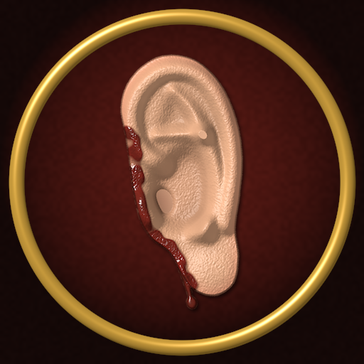

  

# Ear Collector

A World of Warcraft addon for **WoW Forever** that collects an ear from every
enemy player you or your group kill in the open world, like the ears PvP kills
dropped in Diablo II.

- Kills by you, your pet, your group and their pets count. So do assists: kills
  someone outside your group finished after you damaged the victim or earned
  honor for them.
- Battlegrounds, arenas and dungeons never count.
- Each ear shows the victim's race and a grade for how hard-won the kill was.
  Ears go in an Ear Pouch, with a Ledger of totals and a list of Rivals.
- Everything stays on your screen. Ear Collector never posts to chat or sends
  anything other players can see.

Ear Collector is heavily AI-authored. See [How it's made](#how-its-made).

## Install

1. Download `EarCollector-<version>-forever.zip` from the
   [releases page](https://github.com/AlexaDeWit/Ear-Collector/releases).
2. Unzip it into the `Interface/AddOns/` folder of your WoW Forever
   installation, so that you have `Interface/AddOns/EarCollector/EarCollector.toc`.
3. Start the game, or type `/reload`.

To update, delete the `EarCollector` folder and unzip the new one. Your ears are
saved outside it. Each character keeps its own collection, and the settings are
shared by all your characters.

## Use

Open the pouch with `/ears`, your bags, the minimap addon drawer, a key binding
(Key Bindings > AddOns), or by clicking an ear's name in chat. Escape closes it.
The options are in Options > AddOns > Ear Collector.

The small coloured buttons at the top left of the Ears tab hide or show each
grade. Click the grey one to put away your Poor ears; they stay saved and still
count in the Ledger and Rivals.

| Command | What it does |
|---|---|
| `/ears` | Open or close the pouch |
| `/ears options` | Open the options |
| `/ears stats` | Your totals and latest ear |
| `/ears recent [n]` | Your newest ears (5 unless you give a number) |
| `/ears bags on\|off` | Open the pouch with your bags |
| `/ears popup on\|off` | The pop-up when you collect an ear |
| `/ears popup move` | Drag pop-ups where you want them |
| `/ears popup reset` | Put pop-ups back near the top of the screen |
| `/ears sound on\|off` | The pop-up's sound |
| `/ears debug` | Print and save what the addon sees, for testing and bug reports |
| `/ears errors` | Errors the addon caught (it keeps running) |

### Grades

An ear's grade says how much the kill felt like an achievement, from Poor to
Common, Uncommon, Rare, Epic and Legendary. Each of these counts for or against:

- **The odds:** being outnumbered counts for you, outnumbering them counts against.
- **The danger to you:** how much damage you took, in health bars.
- **How strong they were:** their health compared with yours counts for more
  than how long the fight lasted, so a quick burst on a big target is rewarded.
- **How fast they fell:** bringing them down within seconds counts for you,
  unless they were lower than you and smaller, or you had them outnumbered.
- **Whether they fought back:** picking off a smaller, lower player who never
  hit you counts against you.
- **Your part:** your healing and shields, your side's interrupts and dispels,
  and group members who fell.
- **Their level:** every level above you counts for you, and every level below
  against, most of all for orange and red, or green.
- **Revenge:** each time they've killed you since you last killed them. Three
  times makes their next ear Legendary.
- **Repeats:** a second or third ear from the same player in a day counts a
  little less.

The fight is read from the game's damage meter, which addons can only see once
combat ends. So an ear taken in a fight is graded when the fight ends: chat
says "Appraising the fight...", then the pop-up shows the grade. With no record
of the fight, the grade follows the victim's level colour. Grey victims, who give
no honor, are Poor unless revenge raises them.

Hover an ear to see why it has its grade: each reason with a + or -, and
squares for how much it counted. When the kill has a story worth telling, a
gold line tells it in your own words: "They had the edge on me. They never had
the time." or "They should have quit while they were ahead."

Killing the same player again within 10 minutes adds to that ear instead of
dropping a new one. The options set the window.

### Rivals

The Rivals tab lists everyone you've taken an ear from or died to. **Avenge**
means they've killed you since you last killed them, so their next ear is worth
more (Legendary after three times). **Nemesis** means they've killed you more
often than you've killed them, and **Prey** means you've killed them three times
or more and they've never killed you.

Ear Collector keeps your grudges. When someone you owe shows up again on a
later day, chat reminds you, and for Vengeance a pop-up and the raid warning
sound do too. Reminders come only out of combat. Someone who killed you an hour ago won't set it off, and neither
will the same player again that day. Hovering anyone you owe shows the grudge
on their tooltip.

### What it can't see

WoW Forever doesn't give addons the combat log, so Ear Collector works from the
game's kill and honor reports and its damage meter.

- An assist counts only when the enemy player dies near you.
- Who killed you comes from the death recap, matched against the enemy players
  you could see or had hit. If none of them matches, the death isn't recorded.

## How it's made

Ear Collector is heavily AI-authored. Claude Code, Anthropic's coding agent,
wrote most of the code, the tests, the documentation, and the scripts that paint
the ears and the logo. The maintainer decides what it does and how it looks,
merges every change, and tests it in the game. Every AI-assisted commit carries
an `Assisted-by:` trailer, and [`CONTRIBUTING.md`](CONTRIBUTING.md) has the
rules AI-assisted contributions follow.

## Reporting a bug

Open an [issue](https://github.com/AlexaDeWit/Ear-Collector/issues) and include
what `/ears errors` lists.

## Contributing

See [`CONTRIBUTING.md`](CONTRIBUTING.md).

## Licence

[MIT](LICENSE)
