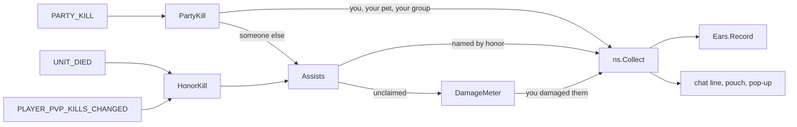

# Architecture

How Ear Collector turns game events into ears, and why it's built the way it is.
Read it before a structural change. The game facts it relies on are in
[`forever-api.md`](forever-api.md).

## Layout

Decisions live in plain functions that specs call directly. The code that talks
to the game stays thin.

| Path | Role |
|---|---|
| `Core/Init.lua` | Namespace, version, grade colours |
| `Core/Errors.lua` | Error containment |
| `Core/Events.lua` | The `ns.On(event, fn)` dispatcher |
| `Core/Database.lua` | Saved data: repair on load, the `ns.db` view |
| `Core/Context.lua` | Whether a kill here counts; secret-safe reads |
| `Core/Ears.lua` | Grading and recording ears |
| `Core/Assists.lua` | Matching honorable kills and damage to deaths |
| `Core/Deaths.lua` | Recording deaths, reading the recap, matching killers, vengeance |
| `Core/Ledger.lua`, `Core/Rivals.lua` | Totals and per-player rows for the pouch's tabs |
| `Detectors/` | Event handlers: kills (`PartyKill`), assists (`HonorKill`, `DamageMeter`), your deaths (`Death`), and what they share (`Shared`) |
| `UI/Pouch.lua` | The Ear Pouch window, its tab strip and paging |
| `UI/EarsTab.lua`, `UI/LedgerTab.lua`, `UI/RivalsTab.lua` | The pouch's three tabs |
| `UI/Toast.lua` | The pop-up when you collect an ear |
| `UI/Options.lua` | The page in Options > AddOns |
| `UI/Access.lua` | Ways to open the pouch: drawer, key binding, bags, chat links |
| `UI/Chat.lua`, `UI/Slash.lua` | Chat lines, ear links, and the `/ears` commands |
| `UI/Art.lua` | Race to ear-texture mapping |
| `Bindings.xml` | The "Toggle Ear Pouch" key binding |
| `Media/Ears/` | Ear textures, painted by `art/paint_ears.py` ([art.md](art.md)) |

The TOC loads `Core` first, then the UI helpers the detectors call, then the
detectors, then the windows.

## From a kill to an ear

**Kills.** `Detectors/PartyKill.lua` handles `PARTY_KILL`. It checks the location
first (`Context.Current`), then that both GUIDs are readable, then that the
victim is a player. `ns.ClassifyKiller` decides whether the killer was you,
your pet, a group member or a group member's pet. `ns.VictimDetails` reads the
victim's name, surname, class, race and level.

**Where kills count.** `Context.Classify` accepts the open world only.
Battlegrounds, arenas, dungeons, raids and scenarios never count. Zone-wide
battles and free-for-all areas count only when their options are on.

**Grades.** `Ears.Grade` follows the colour the game gives the victim's level
([forever-api.md](forever-api.md#kills)): red (5 or more above you) is Epic,
orange (3 or 4 above) Rare, yellow (4 below to 2 above) Uncommon, green
Common, and grey Poor. How far below you green reaches comes from
`UnitQuestTrivialLevelRange("player")` at the kill, which varies with your
level, and is 9 levels when the game doesn't say. A vengeance kill is
Legendary.

**Repeat kills.** Killing the same player again within `campWindow` (10 minutes
by default) adds to that ear's count and restarts the window, instead of
dropping a new ear.

**Assists.** An assist starts with an enemy player's death near you:
`UNIT_DIED`, or a `PARTY_KILL` by someone outside your group. There's no combat
log, so two kinds of evidence say you took part (`Core/Assists.lua`).

Honor comes first (`Detectors/HonorKill.lua`):

- An honorable-kill step is matched to a death within `Assists.WINDOW` (2.5)
  seconds.
- Each death and each credit starts a matching pass half a second after its
  window closes, because the events arrive in any order.
- Credits and the deaths near them form connected groups, and each group
  resolves as a whole once nothing in it is newer than the window. Two enemies
  dying a second apart then get one assist each.
- A credit next to your group's own kill belongs to that kill, unless the
  victim was grey to you: that kill gave no credit, so it uses none.
- More deaths than credits names nobody, and the credit is counted in
  `stats.unnamedHonorKills`.

A death no credit named is unclaimed, and the damage meter decides it
(`Detectors/DamageMeter.lua`):

- It's an assist if the meter shows you or your group damaged that player, and
  the death came during your fight or within `Assists.RECENT` (60) seconds after
  it ended. Grey victims give no honor, so this is the only way they become
  assists.
- The meter's data is secret in combat, so unclaimed deaths wait until combat
  ends. A death after your fight is checked as soon as it's unclaimed.
- Each death is judged against the fight it happened in, and that fight's meter
  session is noted when combat ends, so a new fight doesn't hide an old one.
- Your group's own kills are never unclaimed, so they can't become assists too.

## Deaths and vengeance

The death recap is the only record of who killed you
(`Detectors/Death.lua`, `Core/Deaths.lua`).

1. On `PLAYER_DEAD` in a place that counts, `DeathWatch` notes the enemy players
   in view: target, focus, mouseover and every nameplate on screen.
2. After `DeathWatch.RECAP_DELAY` (1 second) it reads the recap's killing blow.
3. A readable player `sourceGUID` identifies the killer, unless it's you or your
   group. Otherwise the recap's name must match one seen player exactly: their
   name, its first word, or name and surname joined by a space or a hyphen. A
   form two players share matches nobody.
4. If no player in view matches, the enemy players on the damage meter (those
   you or your group hit) get the same test. No match records nothing.

`Deaths.VENGEANCE` (3) deaths to one player since you last killed them make their
next ear Legendary, even inside the repeat-kill window. Taking that ear clears
the debt.

The Rivals tab marks each player with at most one of these, in this order:

| Mark | When |
|---|---|
| Avenge | Vengeance is owed |
| Nemesis | They killed you twice or more, and more often than you killed them |
| Prey | You killed them three or more times, and they never killed you |

## Saved data

| Global | Saved for | Holds |
|---|---|---|
| `EarCollectorDB` | The account | `settings`, `ui` (pouch position), `errors`, `debugLog` |
| `EarCollectorCharDB` | Each character | `ears`, `deaths`, `stats` |

- `Database.MigrateAccount` and `Database.MigrateCharacter` repair whatever is
  on disk at `ADDON_LOADED`: missing tables, wrong types, damaged records.
  Saved data can be old, hand-edited or truncated, so code that reads a field
  still tolerates it missing.
- Schema 1 kept ears account-wide. `Database.MoveShared` moves them to the first
  character that loads, and drops nothing.
- `ns.db` is a view whose fields are the saved tables themselves
  (`Database.View`). Change them in place (`Database.Clear` empties a list).
  Reassigning a field would stop it being saved, and the options page holds a
  reference to `db.settings`.
- The addon reads settings when it needs them and caches none, so a change
  takes effect without a callback.
- Every log is bounded: 20 errors, 300 debug entries.

## Error containment

An error that escapes an addon reaches the player as a popup. Repeated errors lag
the client, and the game may suggest disabling every addon. `Core/Errors.lua`
keeps them inside:

- Every entry point runs in `Errors.Call` or `Errors.Wrap`. `ns.On` wraps event
  handlers, and slash commands, `C_Timer` callbacks, scripts and hooks are
  wrapped where they're made.
- A caught error goes to `EarCollectorDB.errors` and is announced once per
  session. After `Errors.MAX_PER_HANDLER` (3) errors a name is switched off
  until `/reload`. With `/ears debug` on, errors also go to the game's handler,
  for BugSack.
- Names stay narrow so one failure can't switch off something else:
  - `ns.Collect` and `ns.RecordDeath` run the chat line, the pouch refresh and
    the pop-up under their own names, so a UI bug can't stop kill detection.
  - Each `/ears` command has its own name. `/ears errors` and `/ears help` are
    never switched off.
  - Reading the damage meter has its own name, so a change in the meter can't
    stop honor assists or kills.
  - Each pouch tab builds and refreshes under its own name, so a broken tab is
    skipped.
  - The pouch window builds all or nothing. A failed build keeps it closed
    until `/reload` instead of failing on every refresh.

The wrapper is a safety net. The code prevents errors in the first place:
`Context.Readable` before touching any value from the game, a nil check on
every API return, and repair of saved data on load.

## The pouch and its ways in

- `UI/Pouch.lua` builds the window on first open, from
  `BasicFrameTemplateWithInset`. Tabs register with
  `Pouch.AddTab{ title, build, refresh, pages?, setPage? }` while the addon
  loads, and the page buttons page whichever tab is showing.
- `UI/Access.lua` connects the ways to open it:
  - The minimap drawer: left-click toggles the pouch, right-click opens the
    options.
  - The key binding in `Bindings.xml`.
  - Your bags, through `hooksecurefunc` post-hooks on the bag functions. The
    pouch closes with the bags only if the bags opened it, and a merchant, bank,
    mailbox or trade window opening your bags leaves it closed.
  - Ear links in chat: `|Haddon:EarCollector:ear:<guid>:<time>|h`. Hovering
    one shows the ear's tooltip, and clicking it opens the pouch on the ear.
- **Escape.** The pouch appends its frame name to `UISpecialFrames` once, when
  it's built. Blizzard reads that list inside `securecall`, so the addon's entry
  can't taint the rest of Escape. It's the one write to a Blizzard global the
  addon makes. Registering an Escape handler would taint every Escape,
  keyboard propagation is restricted in combat, and a post-hook on
  `ToggleGameMenu` can't stop the game menu opening
  ([details](forever-api.md#interface-hooks)).
- **The pop-up** (`UI/Toast.lua`) stacks upward from bottom centre, above the
  action bars and clear of Blizzard's error and zone text, or from wherever you
  drag the stand-in (`UI/ToastMover.lua`, saved in `db.ui.toast`). It uses
  Blizzard's loot-toast atlases, checked with `C_Texture.GetAtlasInfo`, and plain
  colours without them. A Vengeance ear gets the legendary style, a death a red
  "Ear lost" pop-up. One loot sound plays per burst unless a grander one follows,
  and Poor ears are silent. It is the addon's own frames on `UIParent`, not Blizzard's alert
  system, which could spread taint. Animation groups fade it, with no
  `OnUpdate`. Up to `Toast.MAX` (3) stack. Only new ears get one.
- **The options page** uses the Settings API. Checkboxes bind straight to
  `db.settings`. The repeat-kill slider is a proxy setting (minutes on screen,
  seconds saved) whose getter and setter run in `Errors.Call`, because Blizzard
  calls them where an error would reach the player. In combat, `/ears options`
  says it can't open instead of calling a restricted function.

## Nothing leaves your screen

Chat lines go to your own chat window through `print`, and pop-ups and sounds
play only on your client. The addon never calls `SendChatMessage`,
`C_ChatInfo.SendAddonMessage`, `DoEmote` or anything else other players could
see or hear, so it can't break anyone's immersion on a roleplaying realm.

## The debug log

`/ears debug` prints each decision and saves it in `EarCollectorDB.debugLog`
(`ns.Trace` in `Detectors/Shared.lua`). It's how in-game results become test
fixtures ([testing.md](testing.md#fixtures-from-the-game)).

- Each entry has `at` (server time), `t` (`GetTime()` to the millisecond), the
  event, the attacker and target (`<secret>` when hidden), the decision and the
  active addon restrictions.
- Decisions about things that never count (NPC kills, kills in dungeons, honor
  in battlegrounds) go through `ns.TraceRoutine`: three of each kind per
  session, so they can't push PvP lines out.
- A death whose recap name matches nobody lists the names that were in view.
