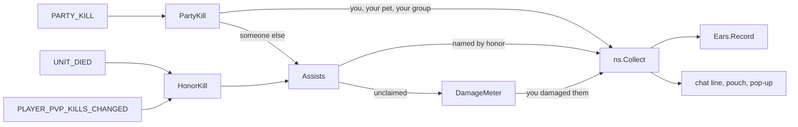

# Architecture

How Ear Collector turns game events into ears, and why it's built the way it is.
Read it before a structural change. The game facts it relies on are in
[`forever-api.md`](forever-api.md).

## Layout

Decisions live in plain functions that specs call directly. The code that talks
to the game stays thin.

| Path | Role |
|---|---|
| `Core/Init.lua` | Namespace, version, grade colours |
| `Core/Errors.lua` | Error containment |
| `Core/Events.lua` | The `ns.On(event, fn)` dispatcher |
| `Core/Database.lua` | Saved data: migration steps and repair on load, the `ns.db` view |
| `Core/Context.lua` | Whether a kill here counts; secret-safe reads |
| `Core/Ears.lua` | Grading and recording ears |
| `Core/Assists.lua` | Matching honorable kills and damage to deaths |
| `Core/Appraisal.lua` | An ear's grade from its fight: bands, score, grade buckets |
| `Core/Deaths.lua` | Recording deaths, reading the recap, matching killers, vengeance |
| `Core/Ledger.lua`, `Core/Rivals.lua` | Totals and per-player rows for the pouch's tabs |
| `Detectors/` | Event handlers: kills (`PartyKill`), assists (`HonorKill`, `DamageMeter`), the fight behind an ear (`FightFacts`), your deaths (`Death`), grudges you see (`Grudges`), and what they share (`Shared`) |
| `UI/Pouch.lua` | The Ear Pouch window, its tab strip and paging |
| `UI/EarsTab.lua`, `UI/LedgerTab.lua`, `UI/RivalsTab.lua` | The pouch's three tabs |
| `UI/GradeFilter.lua` | The Ears tab's grade buttons, which hide or show each grade |
| `UI/Toast.lua` | The pop-up when you collect an ear |
| `UI/Options.lua` | The page in Options > AddOns |
| `UI/Access.lua` | Ways to open the pouch: drawer, key binding, bags, chat links |
| `UI/Chat.lua`, `UI/Slash.lua` | Chat lines, ear links, and the `/ears` commands |
| `UI/Reasons.lua` | Each reason for a grade in words: its tooltip line and its part in the story |
| `UI/FightSummary.lua` | The words for an ear's grade: the reason lines, the story, the pop-up's reason |
| `UI/Art.lua` | Race to ear-texture mapping |
| `Bindings.xml` | The "Toggle Ear Pouch" key binding |
| `Media/Ears/` | Ear textures, painted by `art/paint_ears.py` ([art.md](art.md)) |

The TOC loads `Core` first, then the UI helpers the detectors call, then the
detectors, then the windows.

## From a kill to an ear

**Kills.** `Detectors/PartyKill.lua` handles `PARTY_KILL`. It checks the location
first (`Context.Current`), then that both GUIDs are readable, then that the
victim is a player. `ns.ClassifyKiller` decides whether the killer was you,
your pet, a group member or a group member's pet. `ns.VictimDetails` reads the
victim's name, surname, class, race and level.

**Where kills count.** `Context.Classify` accepts the open world only.
Battlegrounds, arenas, dungeons, raids and scenarios never count. Zone-wide
battles and free-for-all areas count only when their options are on.

**Level colours.** `Ears.Grade` follows the colour the game gives the victim's
level ([forever-api.md](forever-api.md#kills)): red is 5 or more above you,
orange 3 or 4, yellow 4 below to 2 above, then green, then grey. How far below
you green reaches comes from `UnitQuestTrivialLevelRange("player")` at the kill,
which varies with your level, and is 9 levels when the game doesn't say. Grey
victims give no honor (`Ears.IsTrivial`).

**Grades.** An ear's grade comes from `Appraisal.Appraise` (design: issue #46):
- Each signal falls into a named band worth some points (`Appraisal.SIGNALS`):
  the odds, your damage taken in health bars, the victim's health against
  yours, the fight's length or a kill within `Appraisal.BURST` (8) seconds, a
  one-sided fight against a smaller, lower foe, the victim's toughness, your
  healing and absorbs, interrupts and dispels, group members who fell, your own
  death, the level (orange, red and green by colour, and within yellow
  `Appraisal.LEVEL_STEP` per level, no lower than `Appraisal.LEVEL_FLOOR`),
  revenge (deaths owed), earlier ears from the player that day, and an assist
  where the meter shows you took little damage and healed little.
- A burst doesn't count against someone lower than you (unless they had your
  health or more), nor when you had them outnumbered two to one.
- Being outnumbered and the fight's length count only when you took a quarter of
  your health or more (`Appraisal.CONTESTED`). A signal the game didn't give is
  worth nothing, so without a fight record the grade is the level colour's.
- The total falls into `Appraisal.BUCKETS`, which widen as grades rise. Three
  deaths owed (`Deaths.VENGEANCE`) is always Legendary. A grey victim is Poor,
  raised one grade per death owed. Any other ear is at least Common.

**Grading after the fight.** `ns.Collect` gives a new ear its grade from the
kill alone, then hands it to `FightFacts.Hold`. Out of combat the ear is graded
at once, from your last fight only if it ended within `Assists.RECENT` (60
seconds), so a kill your group makes while you aren't fighting isn't graded from
an old fight. In combat it waits: chat says "Appraising the fight...", and when
combat ends (`PLAYER_REGEN_ENABLED`, then `DamageMeter.SETTLE`) the meter's
views for that fight are read once, every waiting ear is graded, and each gets
its chat line and pop-up. If combat goes on for `FightFacts.WAIT` (30 seconds)
after a kill, its pop-up shows ungraded. Every new ear saves how it was graded
as `fight` (`Appraisal.Record`): the bands that counted, each one's points, the
level gap, and the rule (`vengeance` or `grey`) when one set the grade instead
of the score.
Once the fight is read, its facts join them. `/ears debug` logs the arithmetic.
Camped repeats are never graded.

**Wording.** `FightSummary` builds the words from that saved record, with each
reason's own words from `Reasons`. Under "Why it's <grade>", every reason that
counted gets a line with + or - and one to three squares for how much, so the
list accounts for the whole grade. The gold story closes the tooltip and
follows the grade in chat, and it's there to be fun: it tells the most
memorable part of the kill (a grudge settled, or the strongest reasons pointing
the same way), and there's none when the kill has nothing worth telling, such as
a small markdown alone. The pop-up names the strongest reason. A new band needs
a line and a story part in `Reasons` (a fragment, and a punchline for when it
stands alone), in this voice:

- Use a player's units: health bars, "1v3", levels, time in combat.
- Claim only what the band's test proves. Round amounts down and say "over" or
  "nearly", never "nearly died" for damage taken, and "your side" for a count
  that includes your group.
- No list line starts with a digit, since after a sign it reads as a stat.
- "Group member", never "ally", which reads as an Alliance player. "They" for
  the victim.
- Punchy and concrete in the story, never mocking the victim, and never a guess
  at what they saw or meant: the facts carry the drama.

**Repeat kills.** Killing the same player again within `campWindow` (10 minutes
by default) adds to that ear's count and restarts the window, instead of
dropping a new ear.

**Assists.** An assist starts with an enemy player's death near you:
`UNIT_DIED`, or a `PARTY_KILL` by someone outside your group. There's no combat
log, so two kinds of evidence say you took part (`Core/Assists.lua`).

Honor comes first (`Detectors/HonorKill.lua`):

- An honorable-kill step is matched to a death within `Assists.WINDOW` (2.5)
  seconds.
- Each death and each credit starts a matching pass half a second after its
  window closes, because the events arrive in any order.
- Credits and the deaths near them form connected groups, and each group
  resolves as a whole once nothing in it is newer than the window. Two enemies
  dying a second apart then get one assist each.
- A credit next to your group's own kill belongs to that kill, unless the
  victim was grey to you: that kill gave no credit, so it uses none.
- More deaths than credits names nobody, and the credit is counted in
  `stats.unnamedHonorKills`.

A death no credit named is unclaimed, and the damage meter decides it
(`Detectors/DamageMeter.lua`):

- It's an assist if the meter shows you or your group damaged that player, and
  the death came during your fight or within `Assists.RECENT` (60) seconds after
  it ended. Grey victims give no honor, so this is the only way they become
  assists.
- The meter's data is secret in combat, so unclaimed deaths wait until combat
  ends. A death after your fight is checked as soon as it's unclaimed.
- Each death is judged against the fight it happened in, and that fight's meter
  session is noted when combat ends, so a new fight doesn't hide an old one. A
  fight has a session of its own only if the newest one changed since the last
  fight ended (or since you logged in); otherwise it has none, and its kills
  are graded by the kill alone.
- Your group's own kills are never unclaimed, so they can't become assists too.

## Deaths and vengeance

The death recap is the only record of who killed you
(`Detectors/Death.lua`, `Core/Deaths.lua`).

1. On `PLAYER_DEAD` in a place that counts, `DeathWatch` notes the enemy players
   in view: target, focus, mouseover and every nameplate on screen.
2. After `DeathWatch.RECAP_DELAY` (1 second) it reads the recap's killing blow.
3. A readable player `sourceGUID` identifies the killer, unless it's you or your
   group. Otherwise the recap's name must match one seen player exactly: their
   name, its first word, or name and surname joined by a space or a hyphen. A
   form two players share matches nobody.
4. If no player in view matches, the enemy players on the damage meter (those
   you or your group hit) get the same test. No match records nothing.

Each death to a player since you last killed them raises their next ear's
grade (revenge). `Deaths.VENGEANCE` (3) of them make it Legendary, even inside
the repeat-kill window. Taking an ear from them clears the debt.

The Rivals tab marks each player with at most one of these, in this order:

| Mark | When |
|---|---|
| Avenge | Vengeance is owed: three deaths |
| Nemesis | They killed you twice or more, and more often than you killed them |
| Avenge | Revenge is owed: one or two deaths |
| Prey | You killed them three or more times, and they never killed you |

**Grudges.** A player you owe (`Deaths.Debt` above zero) is a grudge, and
`Detectors/Grudges.lua` notices one when the game shows them to you:
`NAME_PLATE_UNIT_ADDED`, `PLAYER_TARGET_CHANGED` or `UPDATE_MOUSEOVER_UNIT`, in a
place where kills count. A sighting reminds you only of an old grudge
(`Deaths.Reminder`): you last fought them on an earlier day and at least
`Deaths.GRUDGE_AGE` (6 hours) ago, and you haven't been reminded of them today.
So a day of back and forth stays quiet. A reminder comes only out of combat:
seeing them first in combat counts as meeting them, so none comes that day. A reminder is a chat line, plus for
Vengeance a red pop-up and the raid warning sound (`grudgeSound`). Hovering a
player you owe always adds the grudge to their tooltip, through
`TooltipDataProcessor`. The reminders of the day are kept only until you log
out.

## Saved data

| Global | Saved for | Holds |
|---|---|---|
| `EarCollectorDB` | The account | `settings`, `ui` (pouch position), `errors`, `debugLog` |
| `EarCollectorCharDB` | Each character | `ears`, `deaths`, `stats`, `hiddenGrades` (grades the Ears tab hides) |

`ns.db` is a view whose fields are the saved tables themselves
(`Database.View`). Change them in place (`Database.Clear` empties a list).
Reassigning a field would stop it being saved, and the options page holds a
reference to `db.settings`. The addon reads settings when it needs them and
caches none, so a change takes effect without a callback. Every log is
bounded: 20 errors, 300 debug entries.

### Loading

At `ADDON_LOADED`, before anything else can read saved data:

1. `Database.MoveShared` moves ears saved account-wide (schema 1) to the first
   character with none of its own. It runs on every load, because the ears
   wait for such a character.
2. `Database.MigrateAccount` and `Database.MigrateCharacter` bring each table
   up to `Database.SCHEMA`. The steps in `Database.STEPS` that the table hasn't
   had run once each, in order, on a copy. The copy replaces the table only if
   every step finishes. If one fails, the table stays exactly as it was, at its
   old schema, the error goes to `/ears errors`, and the steps run again next
   load.
3. They then repair damage: missing tables, wrong types, damaged records. Code
   that reads a field still tolerates it missing. An ear still marked `pending`
   (a reload mid-fight) keeps its grade.
4. A table saved by a newer version (its schema is above `Database.SCHEMA`)
   gets no steps, keeps its schema and everything in it, and the player is told
   once in chat.
5. `ns.db` is built from the result.

| Schema | Saved by | Change |
|---|---|---|
| 1 | Builds before v1.0 | Ears, deaths and stats saved account-wide |
| 2 | v1.0 | Moved per character (`MoveShared`) |
| 3 | v2.0 | Every ear keeps how it was graded (`fight.points`, `fight.rule`). Older ears get the record that grading by level colour would save, when it gives the grade they have |

### Changing what's saved

Every release must load the saved files of every earlier release, and leave a
newer release's files intact, so a player can go back a version and forward
again without losing anything.

- **Add fields. Never rename, retype or reuse one.** An older version keeps
  reading the old field. When a meaning changes, add a new field.
- **Read defensively.** Tolerate any field missing, and skip a value you don't
  know, such as a band name from a newer version.
- **Repair only what you know.** Repair drops a known field of the wrong type.
  It never drops a field it doesn't know, which may come from a newer version.
- **Save decisions, not just inputs.** When the addon works something out that
  it shows later, such as a grade and its reasons, save the result. Then
  retuning the rules never needs old code to explain an old record.
- **A change of shape is a step.** Raise `Database.SCHEMA`, add the step to
  `Database.STEPS.account` or `.character` under the new number, and add a row
  to the table above. A step:
  - gets the table as the schema before it left it, possibly damaged, so it
    checks a value's type before trusting it;
  - leaves a record that's already in the new shape alone, because a failed
    load runs it again over records saved since;
  - works on the saved tables alone: no game API, and no `ns.db`;
  - never deletes the player's ears or deaths;
  - keeps working forever, since a player can jump straight from v1.0 to the
    latest release.
- **Record a saved file** when a release changes what's saved, and prove every
  release still loads ([testing.md](testing.md#saved-files-from-past-releases)).

## Error containment

An error that escapes an addon reaches the player as a popup. Repeated errors lag
the client, and the game may suggest disabling every addon. `Core/Errors.lua`
keeps them inside:

- Every entry point runs in `Errors.Call` or `Errors.Wrap`. `ns.On` wraps event
  handlers, and slash commands, `C_Timer` callbacks, scripts and hooks are
  wrapped where they're made.
- A caught error goes to `EarCollectorDB.errors` and is announced once per
  session. After `Errors.MAX_PER_HANDLER` (3) errors a name is switched off
  until `/reload`. With `/ears debug` on, errors also go to the game's handler,
  for BugSack.
- Names stay narrow so one failure can't switch off something else:
  - `ns.Collect` and `ns.RecordDeath` run the chat line, the pouch refresh and
    the pop-up under their own names, so a UI bug can't stop kill detection.
  - Each `/ears` command has its own name. `/ears errors` and `/ears help` are
    never switched off.
  - Reading the damage meter has its own name, so a change in the meter can't
    stop honor assists or kills.
  - Each pouch tab builds and refreshes under its own name, so a broken tab is
    skipped.
  - The pouch window builds all or nothing. A failed build keeps it closed
    until `/reload` instead of failing on every refresh.

The wrapper is a safety net. The code prevents errors in the first place:
`Context.Readable` before touching any value from the game, a nil check on
every API return, and repair of saved data on load.

## The pouch and its ways in

- `UI/Pouch.lua` builds the window on first open, from
  `BasicFrameTemplateWithInset`. Tabs register with
  `Pouch.AddTab{ title, build, refresh, pages?, setPage? }` while the addon
  loads, and the page buttons page whichever tab is showing.
- The Ears tab leaves out the grades in `hiddenGrades` (`Ears.Filter`), and its
  count line says how many it hid. Hidden ears still count everywhere else.
  Opening an ear from chat or a pop-up shows its grade again.
- `UI/Access.lua` connects the ways to open it:
  - The minimap drawer: left-click toggles the pouch, right-click opens the
    options.
  - The key binding in `Bindings.xml`.
  - Your bags, through `hooksecurefunc` post-hooks on the bag functions. The
    pouch closes with the bags only if the bags opened it, and a merchant, bank,
    mailbox or trade window opening your bags leaves it closed.
  - Ear links in chat: `|Haddon:EarCollector:ear:<guid>:<time>|h`. Hovering
    one shows the ear's tooltip, and clicking it opens the pouch on the ear.
- **Escape.** The pouch appends its frame name to `UISpecialFrames` once, when
  it's built. Blizzard reads that list inside `securecall`, so the addon's entry
  can't taint the rest of Escape. It's the one write to a Blizzard global the
  addon makes. Registering an Escape handler would taint every Escape,
  keyboard propagation is restricted in combat, and a post-hook on
  `ToggleGameMenu` can't stop the game menu opening
  ([details](forever-api.md#interface-hooks)).
- **The pop-up** (`UI/Toast.lua`) stacks downward from near the top of the
  screen, or from wherever you drag the stand-in (`UI/ToastMover.lua`, saved in
  `db.ui.toast`), growing away from the screen edge it's anchored to. It's a
  plain bronze panel with the ear framed in its grade colour, and a death gets a
  red "Ear lost" one. An ear's pop-up waits for its grade after the fight.
  One loot sound plays per burst unless a grander one follows, and Poor ears are
  silent. It is the addon's own frames on `UIParent`, not Blizzard's alert
  system, which could spread taint. Animation groups fade it, with no
  `OnUpdate`. Up to `Toast.MAX` (3) stack. Only new ears get one.
- **The options page** uses the Settings API. Checkboxes bind straight to
  `db.settings`. The repeat-kill slider is a proxy setting (minutes on screen,
  seconds saved) whose getter and setter run in `Errors.Call`, because Blizzard
  calls them where an error would reach the player. In combat, `/ears options`
  says it can't open instead of calling a restricted function.

## Nothing leaves your screen

Chat lines go to your own chat window through `print`, and pop-ups and sounds
play only on your client. The addon never calls `SendChatMessage`,
`C_ChatInfo.SendAddonMessage`, `DoEmote` or anything else other players could
see or hear, so it can't break anyone's immersion on a roleplaying realm.

## The debug log

`/ears debug` prints each decision and saves it in `EarCollectorDB.debugLog`
(`ns.Trace` in `Detectors/Shared.lua`). It's how in-game results become test
fixtures ([testing.md](testing.md#fixtures-from-the-game)).

- Each entry has `at` (server time), `t` (`GetTime()` to the millisecond), the
  event, the attacker and target (`<secret>` when hidden), the decision and the
  active addon restrictions.
- Decisions about things that never count (NPC kills, kills in dungeons, honor
  in battlegrounds) go through `ns.TraceRoutine`: three of each kind per
  session, so they can't push PvP lines out.
- A death whose recap name matches nobody lists the names that were in view.
